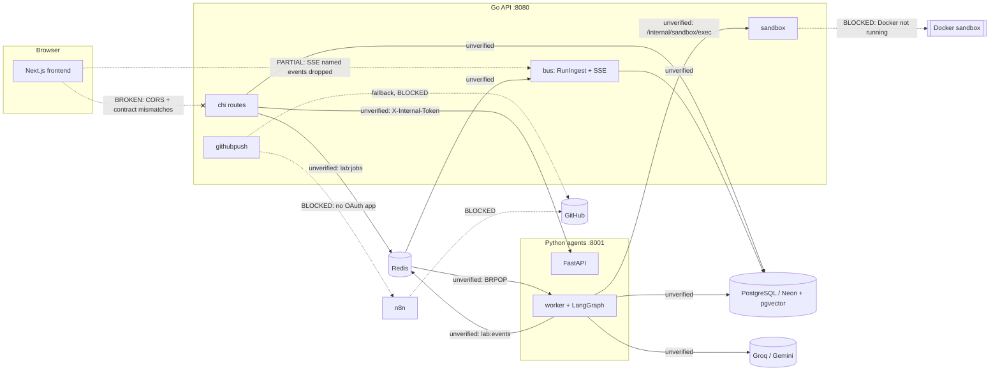

# Pipeline Integration Audit

No pipeline was executed end to end. Redis is not installed, Docker Desktop is not running, and the Go API cannot start without Redis. Every "connected" verdict below is therefore based on matching code on both sides (same key, same fields), **not** on observed traffic.

| Pipeline | Trigger | Path | Data contract | Auth/config | Error / retry | Persistence | Evidence | Status | Missing |
|---|---|---|---|---|---|---|---|---|---|
| A. Frontend → Go | UI action | `services.ts` → fetch/EventSource → chi routes | see API_CONTRACT_MATRIX | cookie + CORS | FE retries GETs (TanStack); BE none | — | code comparison | **BROKEN** | CORS header; ~22 shape mismatches; named-SSE listener gap |
| B. Go → PostgreSQL | any API call | pgxpool → `store/*` | SQL + 4 migrations | `DATABASE_URL` (now Neon) | startup retry 60 s; per-query errors → 500 | ✓ | code | CONNECTED BUT UNVERIFIED | migration lock; live Neon check |
| C. Go → Python (HTTP) | memory search, voice, health | `agentsclient` → FastAPI | `/memory/search`, `/intent`, `/runs/{id}/summary`, `/health` | `X-Internal-Token` both sides ✓ | 30 s timeout; memory falls back to SQL | — | code | CONNECTED BUT UNVERIFIED | correlation IDs (none) |
| D. Job queue | run start / resume / retry / what-if | Go `LPUSH lab:jobs` → Py `BRPOP` | `{type, run_id, …}` keys match ✓ | `REDIS_URL` | **no ack, no retry, no DLQ**; duplicate resume possible | job lost on crash | code | CONNECTED BUT UNVERIFIED | reliable queue (REL-01) |
| E. Agent workflow | `start_run` | graph nodes research→…→finalize | LangGraph state | Groq/Gemini keys or recipe | per-node try; repair loop limit; help checkpoint | LangGraph Postgres checkpointer | code + unit tests of helpers | CONNECTED BUT UNVERIFIED | one real run |
| F. Paper processing | research node | upload/arXiv → LaTeX/PDF → claims → `papers`,`claims` rows + `brief.md` | DB rows | arXiv network | fallbacks LaTeX→PDF→heuristic | ✓ | code | CONNECTED BUT UNVERIFIED | OCR, figure reading |
| G. Experiment execution | execute node | Py → `/internal/sandbox/exec` → `docker run` → `results/metrics.json` → `metrics` rows → scorecard | `ExecRequest/ExecResult` match ✓ | internal token; Docker | timeout kill ✓; non-zero → repair | `sandbox_execs`, `metrics` with hash/commit/line | code | **BLOCKED** (Docker down) | sandbox images built; SEC-01 fix |
| H. Live progress | any emit | Py `LPUSH lab:events` → Go `RunIngest` → `run_events` + SSE → browser | Event JSON fields match ✓ | — | ingest at-most-once; slow SSE clients dropped (recover via /events) | ✓ `run_events` | code | **PARTIALLY CONNECTED** | browser listener set (INT-07); heartbeat event |
| I. Approval & control | checkpoint / pause / stop / instruct | FE → Go → `checkpoints` row + `resume` job / control key → graph `interrupt` resume | Go↔Py ✓; FE↔Go ✗ | — | 409 if not pending ✓ | ✓ | code | **PARTIALLY CONNECTED** | FE body + agent keys |
| J. Results & provenance | metrics ingest | metric → exec → log hash → commit → log line → scorecard → `/metrics/{id}/proof` | ✓ | — | stale `metrics.json` rejected ✓ | ✓ | code | CONNECTED BUT UNVERIFIED | FE uses `ours`; proof card UI |
| K. Lab Memory | finalize / debugger | `memory.add` (embed) → pgvector → `find_fix` before LLM → `mark_used` | ✓ | fastembed optional | hashing fallback | `memory_items` | code + unit | CONNECTED BUT UNVERIFIED | prove reuse across two runs |
| L. GitHub publish | Approve push | FE → Go → bundle → scan → n8n (or direct) → callback → `pushes` | Go↔n8n payload matches workflow JS ✓ | OAuth token, n8n URL | n8n failure → direct fallback ✓; no callback timeout | `pushes` | code | **BLOCKED** (no OAuth app) + FE BROKEN | timeout; FE status path |
| M. Voice / mobile | voice/text command | FE (none) → `/voice/*` → Whisper → `/intent` | BE ✓ | Groq keys | key rotation ✓ | — | code | **DISCONNECTED** (no FE) | UI |
| Share / QR | share link | FE `/share/[token]` → Go share routes | paths ✗ | token | expiry ✓ | `share_links` | code | **PARTIALLY CONNECTED** | FE paths |

## Architecture — actual connection state

Legend: solid line = code on both sides agrees but has not been observed running; dotted = blocked, partial or broken (labelled). **No edge is "connected and verified".**
